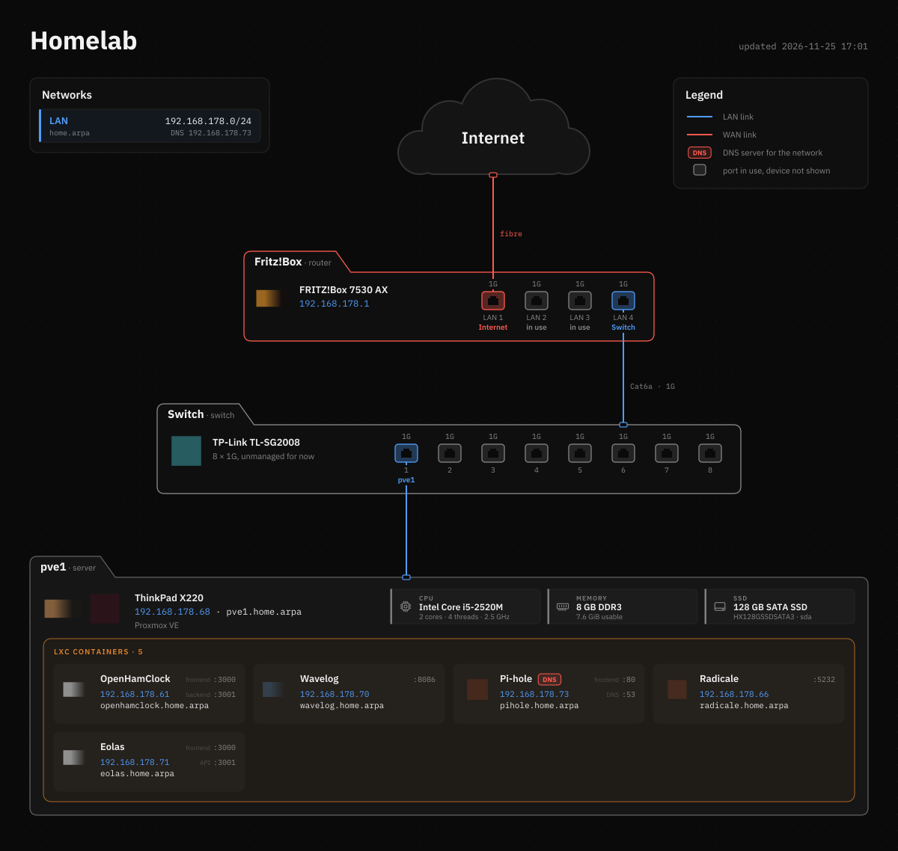

## Homelab 

This repository uses Claude Code to automatically generate a home network diagram and service description READMEs based on the definition of my homelab in [homelab.json](./homelab.json).

Edit `homelab.json`, then run `./claude/generate.sh`.

### Resources

- https://dashboardicons.com/

